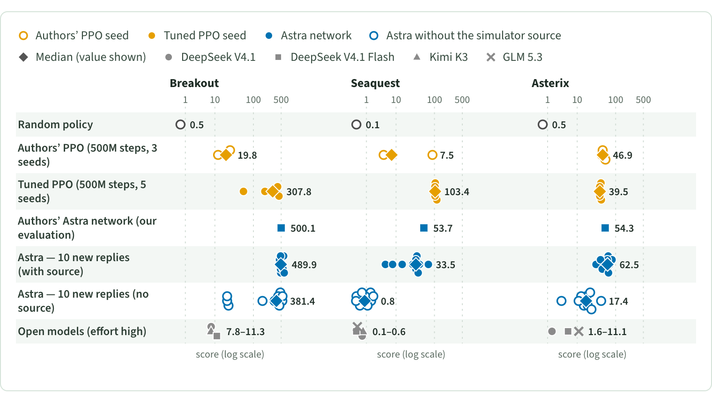
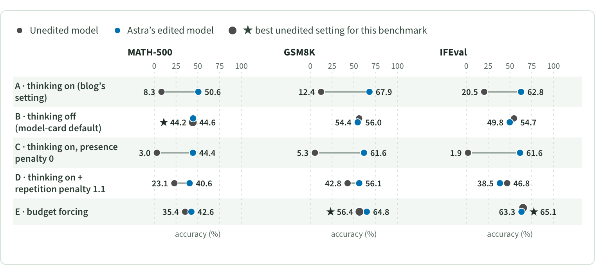

<p align="right"><b>English</b> | <a href="README.zh-CN.md">简体中文</a></p>

<h1 align="center">Rethinking Weight-Space Programming</h1>

<p align="center"><i>Re-running the experiments with baselines and controls</i></p>

<p align="center">
An independent reproduction of <a href="https://rikiyat.github.io/blog/weight-space-programming/">Sparks of Weight-Space Programming</a> (Takehi et al.).
Every reported score we re-ran reproduces; the headline comparisons rest on weak or untuned baselines, single selected runs, and simulator source code in the prompt.
</p>

<p align="center">
  <a href="https://zhangyiqun018.github.io/rethinking-weight-space-programming/"></a>
  <a href="LICENSE"></a>
</p>

<p align="center">
  <a href="https://zhangyiqun018.github.io/rethinking-weight-space-programming/"><b>Read the blog</b></a>
  &nbsp;·&nbsp;
  <a href="https://rikiyat.github.io/blog/weight-space-programming/">Original article</a>
  &nbsp;·&nbsp;
  <a href="https://github.com/RikiyaT/lm_understand-logs">Authors’ logs</a>
  &nbsp;·&nbsp;
  <a href="results/CLAIMS.md">Claims and evidence</a>
</p>

<p align="center">
  
  <br>
  <sub>Experiment 5 (Figure 4 of the blog): each mark is one PPO seed or one Astra reply; diamonds are medians.</sub>
</p>

By **Yiqun Zhang**. The page has an **EN / 中文** toggle and also works offline: open [blog/index.html](blog/index.html).

## TL;DR

- **The scores reproduce, and the abilities are real.** Every reported score we re-ran reproduces, and GPT-6 Astra has real, specific abilities that current open-weight models lack: it reads obvious structure in small networks and compiles explicit programs into weights (Experiment 5 Breakout median 490 over 10 replies; Experiment 6 Go networks beating our 30-line tactical script 90–95% head-to-head).
- **Weak PPO baselines (Experiment 5).** Tuning PPO (512 envs vs CleanRL’s 64, lr 1e-3, 500M steps) lifts Seaquest to 99.2–114.4, about 2× Astra’s 53.1, and shrinks Astra’s Breakout lead from 20× to 1.1–9×.
- **A low bar in Go (Experiment 6).** A fixed 30-line, 1-ply tactics script with no network or search beats the equal-sized PPO networks 74.1% / 61.1% / 69.3%, more than Astra b0’s 42.6% / 26.3% / 36.3%.
- **The math gain is mostly a decoding setting (Experiment 8).** Unedited Qwen3.5-0.8B with thinking off already scores 44.2% on MATH-500, 56.0% on GSM8K and 54.7% on IFEval. Against the best no-edit decoding setting, Astra’s edit adds +6.4, +11.5 and −2.2; a textbook difference-of-means direction with no LLM reaches 41.9% on MATH-500, recovering 79% of Astra’s 8.3% → 50.6% gain.
- **Single selected runs and source code (Experiments 4, 5).** Over 10 fresh replies, Seaquest’s median is 33.5 and only 1/10 reaches 90% of the authors’ network (53.7 in our evaluation); without the simulator’s Python source, medians collapse to 0.8 (Seaquest), 17.4 (Asterix) and 381 (Breakout). In Experiment 4, a 2-parameter open-loop schedule (reverse 16 steps, then drive) nearly solves the task.
- **Reading at scale vs. shallow cues (Experiments 1, 6-read, 7).** A 20-line, 3-rule action-axis script gets 3/4 in Experiment 1 without an LLM. At the 1.5M-weight scale, fresh blind Astra sessions recover code structure but swap b0 and b50 3/3 at 94–99.7% confidence and predict capture, escape and pairwise win rates no better than without weights. Our weight-distance check in Experiment 7 (0/6 discovery, 5/6 confirmation vs a 6/6 bar) is not a reliable classifier.

<p align="center">
  
  <br>
  <sub>Experiment 8 (Figure 10 of the blog): unedited (grey) and edited (blue) model in each decoding configuration; ★ marks the best unedited setting.</sub>
</p>

## Experiments and verdicts

Verdicts are copied from [results/CLAIMS.md](results/CLAIMS.md), which gives the evidence for each claim. ✅ Holds · ⚠️ Overstated · ❌ Contradicted / Not supported (one mark per verdict word; rows without one carry no mark).

| | Question | Verdict |
|---|---|---|
| [**Exp&nbsp;1**](exp1/) | Can models identify games from weights, beyond shallow action cues? | ✅ E1-1: Holds<br>✅ E1-2: Holds (no leakage)<br>⚠️ E1-3: Overstated (identification comes from the action pattern) |
| [**Exp&nbsp;2**](exp2/) | Can simple read-outs identify the diffusion model shapes? | ✅ E2-1: Holds roughly; weak evidence either way. Astra's open-ended 3/3 is better than our candidate-aware script |
| [**Exp&nbsp;3**](exp3/) | Can fixed weight-algebra rules recover language and copying heads? | ✅ E3-1: **Holds** (Astra better than our scripts; its cues are scriptable) |
| [**Exp&nbsp;4**](exp4/) | Does the car edit need closed-loop control? | ✅ E4-1: Holds<br>⚠️ E4-2: Overstated (nearly solvable open-loop; the closed-loop hand-off matters only at the edge of the range) |
| [**Exp&nbsp;5**](exp5/) | How reliable are freshly written game networks, and is the PPO comparison fair? | ✅ E5-1: Holds<br>❌ ⚠️ ✅ E5-2: Contradicted (Seaquest), overstated (Breakout), holds (Asterix)<br>✅ E5-3: Holds (disclosed)<br>✅ ⚠️ E5-4: Holds for Breakout and Asterix; Seaquest overstated (n = 1 above the typical reply); depends on source code |
| [**Exp&nbsp;6**](exp6/) | How strong are Go networks against a fixed script, and can models read their behavior? | ✅ E6-1: Holds as reported, but "beats PPO" is a low bar: a fixed script beats the same PPO by more than Astra b0 does. Astra is genuinely stronger than that script<br>❌ E6-2: Not supported at 1.5M scale: structural facts yes, behaviour no |
| [**Exp&nbsp;7**](exp7/) | Can weight distances identify sycophancy under blinding? | ⚠️ E7-1: Overstated (task framing gives the answer's structure) |
| [**Exp&nbsp;8**](exp8/) | Does the edit improve math beyond decoding changes and standard steering? | ✅ E8-1: Holds<br>⚠️ E8-2: Overstated (baseline choice)<br>⚠️ E8-3: Overstated<br>E8-4: New evidence against "improves instruction following"<br>⚠️ E8-5: Overstated (mostly reachable without an LLM)<br>E8-6: Selective reporting in the text; transparent in the logs<br>⚠️ E8-7: Overstated |

Claim IDs distinguish separate claims within an experiment; the evidence files keep their original caveats and interim notes. The blog is the synthesized account.

## Repository layout

```text
.
├── blog/            the page: index.html (EN / 中文), figure data, page checks
├── exp1/ … exp8/    one folder per experiment: entry scripts, preregistrations, results
├── results/         CLAIMS.md (claims vs evidence), cross-experiment summaries, run summaries
├── docs/            REPRODUCE.md (full reproduction notes) and the images of this README
├── LICENSE          MIT, for our code and text
└── .github/         workflow that publishes blog/ to GitHub Pages
```

## Reproduce

Reading the blog needs nothing but a browser. To check the page and its figure data from the repository root:

```sh
python3 -I blog/validate.py
python3 -I blog/verify/scan_public.py
python3 -I blog/verify/figs/check_data.py
```

Re-running the experiments needs Python 3.12, separate environments per experiment (JAX, PyTorch, model serving), the authors’ released artifacts cloned to `upstream/lm_understand-logs`, and, for the model-calling experiments, an OpenAI-compatible endpoint set through `WSP_API_BASE`, `WSP_API_KEY` and `WSP_MODEL`. Entry scripts, environments, the Exp6 sandbox, the Exp8 benchmark formats, figure checks and what is not shipped are described in **[docs/REPRODUCE.md](docs/REPRODUCE.md)**.

## Citation

```bibtex
@misc{zhang2026rethinking,
  title  = {Rethinking Weight-Space Programming: Re-running the experiments with baselines and controls},
  author = {Zhang, Yiqun},
  year   = {2026},
  url    = {https://zhangyiqun018.github.io/rethinking-weight-space-programming/},
  note   = {Blog post}
}
```

<details>
<summary>The original article</summary>

```bibtex
@misc{takehi2026weightspace,
  title  = {Sparks of Weight-Space Programming: LLMs can natively read \& write neural network weights},
  author = {Takehi, Rikiya and Teoh, Jayden and Zhang, Alex and Khattab, Omar},
  year   = {2026},
  url    = {https://rikiyat.github.io/blog/weight-space-programming/},
  note   = {Blog post}
}
```

</details>

## Acknowledgements

We thank Claude Opus and GPT-6 Astra.

## Licence

Our code and text are under the [MIT License](LICENSE), Copyright (c) 2026 Yiqun Zhang. The page template retains the authors’ separate MIT license in [blog/LICENSE-original.txt](blog/LICENSE-original.txt). The upstream artifacts and independently downloaded models and datasets keep their own licenses; our license does not relicense them.
