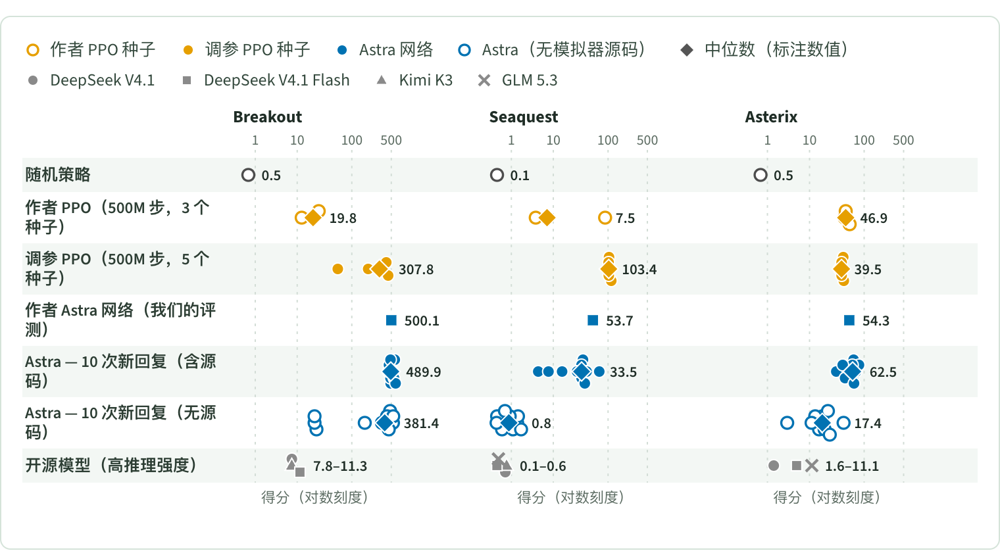
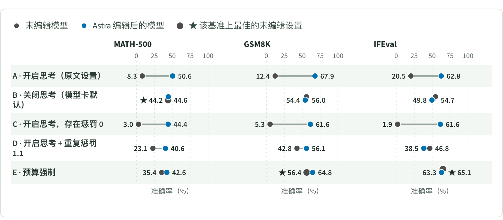

<p align="right"><a href="README.md">English</a> | <b>简体中文</b></p>

<h1 align="center">Rethinking Weight-Space Programming</h1>

<p align="center"><i>重新运行原实验，并补充基线与对照</i></p>

<p align="center">
对 Takehi 等人 <a href="https://rikiyat.github.io/blog/weight-space-programming/">Sparks of Weight-Space Programming</a> 的独立复现。
我们重跑的所有报告分数均得以复现；但原博客最引人注目的对比结论依赖于薄弱或未调优的基线、单次筛选的运行结果，以及提示词中直接提供的模拟器源码。
</p>

<p align="center">
  <a href="https://zhangyiqun018.github.io/rethinking-weight-space-programming/?lang=zh"></a>
  <a href="LICENSE"></a>
</p>

<p align="center">
  <a href="https://zhangyiqun018.github.io/rethinking-weight-space-programming/?lang=zh"><b>阅读博客</b></a>
  &nbsp;·&nbsp;
  <a href="https://rikiyat.github.io/blog/weight-space-programming/">原文</a>
  &nbsp;·&nbsp;
  <a href="https://github.com/RikiyaT/lm_understand-logs">作者公开日志</a>
  &nbsp;·&nbsp;
  <a href="results/CLAIMS.md">主张与证据</a>
</p>

<p align="center">
  
  <br>
  <sub>实验 5（博客图 4）：每个标记为一个 PPO 种子或一次 Astra 回复；菱形为中位数。</sub>
</p>

作者：**Yiqun Zhang**。页面可在 **EN / 中文** 之间切换，也可离线阅读：直接打开 [blog/index.html](blog/index.html)。

## 核心摘要

- **分数可复现，能力真实存在。** 我们重跑的所有报告分数均得以复现，且 GPT-6 Astra 具备当前开源权重模型所不具备的特定真实能力：它能够读取小型网络中的显著结构，并能将给定程序编译进神经网络权重（实验 5 中 Breakout 的 10 次回复中位数为 490；实验 6 围棋网络在对阵我们的 30 行战术脚本时胜率达 90–95%）。
- **PPO 基线偏弱（实验 5）。** 调优 PPO（512 环境对比 CleanRL 默认的 64 环境、学习率 1e-3、500M 步）将 Seaquest 提升至 99.2–114.4（约为 Astra 53.1 的 2×），并使 Astra 在 Breakout 上的领先幅度从 20× 缩小至 1.1–9×。
- **围棋中的低门槛（实验 6）。** 一个不含网络与搜索的 30 行固定 1 步战术脚本对阵同尺寸 PPO 网络的胜率即达 74.1% / 61.1% / 69.3%，高于 Astra b0 的 42.6% / 26.3% / 36.3%。
- **数学提升主要来自解码设置（实验 8）。** 未编辑的 Qwen3.5-0.8B 在关闭思考模式下于 MATH-500、GSM8K 和 IFEval 上已达 44.2%、56.0% 和 54.7%。相比最佳无编辑解码设置，Astra 的编辑仅增 +6.4、+11.5 和 −2.2；无需 LLM 的教科书式均值差方向在 MATH-500 上即可达 41.9%，复现 Astra 从 8.3% 到 50.6% 增益的 79%。
- **单次筛选运行与源码依赖（实验 4、5）。** 在每款游戏 10 次新回复中，Seaquest 中位数仅为 33.5，仅 1/10 达到作者网络（我们评测中为 53.7）的 90%；移除模拟器 Python 源码后，中位得分暴跌至 0.8（Seaquest）、17.4（Asterix）和 381（Breakout）。在实验 4 中，一个 2 参数开环序列（倒车 16 步后前进）几乎可开环解决该任务。
- **大规模读取与浅层线索（实验 1、6-read、7）。** 实验 1 中，20 行 3 规则动作轴脚本无需 LLM 即答对 3/4。在 1.5M 权重规模下，全新的盲测 Astra 会话虽能恢复代码结构特征，却在 3/3 次会话中以 94–99.7% 的置信度将 b0 与 b50 颠倒，且对提子率、逃征率及两两胜率的预测与不给权重时无异。实验 7 中我们的基座权重距离检验（探索集 0/6，确认集 5/6 未达 6/6 门槛）并非可靠分类器。

<p align="center">
  
  <br>
  <sub>实验 8（博客图 10）：各解码配置下未编辑（灰）与编辑后（蓝）模型；★ 为最佳未编辑设置。</sub>
</p>

## 实验与结论

结论措辞照录自 [results/CLAIMS.md](results/CLAIMS.md)（英文），该文件列出每条主张的证据。✅ 成立（Holds）· ⚠️ 高估（Overstated）· ❌ 与证据相悖／不成立（Contradicted / Not supported）；每个结论词对应一个标记，不含结论词的条目不加标记。

| | 问题 | 结论 |
|---|---|---|
| [**实验&nbsp;1**](exp1/) | 模型能否仅凭权重识别游戏，而不只是依靠浅层动作线索？ | ✅ E1-1: Holds<br>✅ E1-2: Holds (no leakage)<br>⚠️ E1-3: Overstated (identification comes from the action pattern) |
| [**实验&nbsp;2**](exp2/) | 简单的读出方法能否识别扩散模型生成的形状？ | ✅ E2-1: Holds roughly; weak evidence either way. Astra's open-ended 3/3 is better than our candidate-aware script |
| [**实验&nbsp;3**](exp3/) | 固定的权重代数规则能否找回语言头与复制头？ | ✅ E3-1: **Holds** (Astra better than our scripts; its cues are scriptable) |
| [**实验&nbsp;4**](exp4/) | 小车的权重编辑是否需要闭环控制？ | ✅ E4-1: Holds<br>⚠️ E4-2: Overstated (nearly solvable open-loop; the closed-loop hand-off matters only at the edge of the range) |
| [**实验&nbsp;5**](exp5/) | 新写出的游戏网络有多可靠？与 PPO 的比较是否公平？ | ✅ E5-1: Holds<br>❌ ⚠️ ✅ E5-2: Contradicted (Seaquest), overstated (Breakout), holds (Asterix)<br>✅ E5-3: Holds (disclosed)<br>✅ ⚠️ E5-4: Holds for Breakout and Asterix; Seaquest overstated (n = 1 above the typical reply); depends on source code |
| [**实验&nbsp;6**](exp6/) | 围棋网络对阵固定脚本有多强？模型能否读出它们的行为？ | ✅ E6-1: Holds as reported, but "beats PPO" is a low bar: a fixed script beats the same PPO by more than Astra b0 does. Astra is genuinely stronger than that script<br>❌ E6-2: Not supported at 1.5M scale: structural facts yes, behaviour no |
| [**实验&nbsp;7**](exp7/) | 在盲测条件下，权重距离能否识别阿谀模型？ | ⚠️ E7-1: Overstated (task framing gives the answer's structure) |
| [**实验&nbsp;8**](exp8/) | 该编辑对数学能力的提升是否超出解码设置与标准方向消除？ | ✅ E8-1: Holds<br>⚠️ E8-2: Overstated (baseline choice)<br>⚠️ E8-3: Overstated<br>E8-4: New evidence against "improves instruction following"<br>⚠️ E8-5: Overstated (mostly reachable without an LLM)<br>E8-6: Selective reporting in the text; transparent in the logs<br>⚠️ E8-7: Overstated |

主张编号区分同一实验中的不同主张；各证据文件保留其原始注意事项与中间记录。博客是综合后的完整论述。

## 仓库结构

```text
.
├── blog/            博客页面：index.html（EN / 中文）、图表数据、页面检查
├── exp1/ … exp8/    每个实验一个目录：入口脚本、预注册、结果
├── results/         CLAIMS.md（主张与证据）、跨实验汇总、运行汇总
├── docs/            REPRODUCE.md（完整复现说明）及本 README 的图片
├── LICENSE          MIT，适用于我们的代码与文字
└── .github/         将 blog/ 发布到 GitHub Pages 的工作流
```

## 复现

阅读博客只需浏览器。在仓库根目录检查页面及其图表数据：

```sh
python3 -I blog/validate.py
python3 -I blog/verify/scan_public.py
python3 -I blog/verify/figs/check_data.py
```

重跑实验需要 Python 3.12、按实验分开的环境（JAX、PyTorch、模型服务）、克隆到 `upstream/lm_understand-logs` 的作者公开产物；调用模型的实验还需通过 `WSP_API_BASE`、`WSP_API_KEY` 与 `WSP_MODEL` 设置一个兼容 OpenAI 的接口。入口脚本、环境、实验 6 的沙箱、实验 8 的基准数据格式、图表检查以及未随仓库提供的内容，见 **[docs/REPRODUCE.md](docs/REPRODUCE.md)**（英文）。

## 引用

```bibtex
@misc{zhang2026rethinking,
  title  = {Rethinking Weight-Space Programming: Re-running the experiments with baselines and controls},
  author = {Zhang, Yiqun},
  year   = {2026},
  url    = {https://zhangyiqun018.github.io/rethinking-weight-space-programming/},
  note   = {Blog post}
}
```

<details>
<summary>原文</summary>

```bibtex
@misc{takehi2026weightspace,
  title  = {Sparks of Weight-Space Programming: LLMs can natively read \& write neural network weights},
  author = {Takehi, Rikiya and Teoh, Jayden and Zhang, Alex and Khattab, Omar},
  year   = {2026},
  url    = {https://rikiyat.github.io/blog/weight-space-programming/},
  note   = {Blog post}
}
```

</details>

## 致谢

感谢 Claude Opus 和 GPT-6 Astra。

## 许可证

我们的代码与文字采用 [MIT 许可证](LICENSE)，Copyright (c) 2026 Yiqun Zhang。页面模板保留作者单独的 MIT 许可证，见 [blog/LICENSE-original.txt](blog/LICENSE-original.txt)。上游产物以及另行下载的模型与数据集保留各自的许可证；我们的许可证不对其重新授权。
